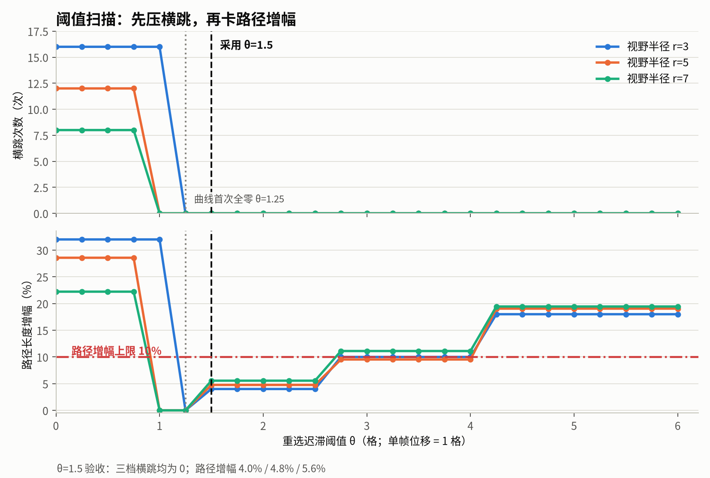

# explore

迷雾边缘的目标资格、可达性判定与重选迟滞。纯 C11 自检测试，阈值扫描用
Python 标准库复现；画图另需 `matplotlib`。

```sh
make test       # C 判据/迟滞自检 + 三档半径阈值验收
make calibrate  # 重新生成 docs/curves.csv 与 docs/summary.json
make chart      # 生成 docs/explore-curves.png
```



> 仓库快照里没有原始回放文件，也没有给出三档视野半径的具体数值。下面用
> `r = 3, 5, 7` 格作为低/中/高三档，并把题面描述的“每帧重选、两步一退”
> 固化成确定性的回归夹具（见 `tools/calibrate.py` 的 `EDGE_FIXTURE`）。
> 因此这些数字验证的是判据和标定流程；接入真实回放时，只需用真实帧序列替换
> 夹具，选择规则和验收不等式不变。

## 1. 可选目标判据

设 `seen[t]` 表示格子 \(t\) 已探索，`reach_k(a,t)` 表示只穿过**已探索且未阻挡**
格子时，角色 \(a\) 能否到达 \(t\)。候选目标的两个条件必须同时成立：

\[
\boxed{\operatorname{selectable}(a,t)
= \operatorname{explored}(t)\land \operatorname{reachable}_{known}(a,t)}
\]

对应 C 代码（`src/explore.c`）：

```c
static int target_selectable(const FogMap* m, int ax, int ay, int tx, int ty) {
    int t = idx(tx, ty);
    if (!explored_cell(m, t)) return 0;                /* 条件一：已探索 */
    return reachable_known(m, ax, ay, tx, ty);          /* 条件二：可达   */
}
```

完整的“已探索区域边界目标”还要再加边界条件：

\[
\operatorname{candidate}(a,t)
= \operatorname{frontier}(t)
\land \operatorname{explored}(t)
\land \operatorname{reachable}_{known}(a,t),
\]

其中

\[
\operatorname{frontier}(t)
= knownFree(t)\land
\exists u\in N_4(t): \operatorname{inside}(u)\land\neg explored(u).
\]

关键是 `reachable_known()` 的 BFS 只走 `explored && !blocked` 的格子。未知区域
即使在真实地图上是空地，也不能被 BFS 当成可走捷径；这正是旧逻辑“把未知区域
当成可走”的缺口。自检分别覆盖：

- 未知但真实开放的格子被拒绝；
- 已探索但被未探索走廊/全高墙隔开的格子被拒绝；
- 连接廊探索后转为可达；
- 已探索的阻挡格被拒绝。

## 2. 重选阈值：从横跳曲线反解

这里把阈值实现为**代价迟滞余量** \(\theta\)（单位：格，代价用已知雾图上的
A*/BFS 路径长度）。若当前目标仍合法，挑战者的代价必须有显著优势才替换：

\[
\operatorname{reselect}(c,b,\theta)
= \neg eligible(c)
\lor \left[eligible(b)\land J(b)+\theta<J(c)\right].
\]

如果现有代码的阈值是目标点位置变化量而不是代价差，则使用等价的空间死区形式：

\[
\operatorname{switch}_{pos}(c,b,\rho)
= \neg eligible(c)\lor
\left[\lVert p_b-p_c\rVert_2>\rho\right].
\]

单帧位移 \(s=1\) 格时，一帧运动最多让邻近目标的距离/路径代价排序发生同量级
变化，所以必要下界是：

\[
\boxed{\theta>s=1}
\]

回放反解时，先统计误切换帧中挑战者与在选目标的最大代价差，再加小量化裕量：

\[
\theta_{\rm inv}
= \max_{f\in\mathrm{false\_flips}}
  \left(J_{\rm incumbent,f}-J_{\rm challenger,f}\right)+\epsilon.
\]

若阈值实现为位置死区，则改为取误切换目标点之间的最大位移：

\[
\rho_{\rm inv}
= \max_{f\in\mathrm{false\_flips}}
  \left\lVert p_{\rm new,f}-p_{\rm old,f}\right\rVert_2+\epsilon.
\]

这只是反解初值；最终值必须通过整条 \(\theta\) 网格扫描验收。对每个视野半径
\(r\)，统计横跳次数 \(O_r(\theta)\) 与路径长度 \(L_r(\theta)\)：

\[
\theta_{\rm zero}
= \inf\{\theta:\ \forall r,\ O_r(\theta)=0\},
\]

\[
\Theta_{\rm path}
= \left\{\theta:\ \forall r,\
\frac{L_r(\theta)-L_r^{\rm oracle}}{L_r^{\rm oracle}}\le 0.10\right\},
\]

\[
\theta^*=\min\left([\theta_{\rm zero},\infty)\cap\Theta_{\rm path}\right).
\]

扫描结果：

| 阈值 \(\theta\) | 首个全零档位 | 说明 |
|---:|---|---|
| \(0\)–\(1.00\) | 否 | \(r=3\) 的最大排序摆动为 \(1.10\)，仍会触发重选 |
| \(1.25\) | **是** | 三档横跳首次全零，路径增幅 \(0\%\) |
| \(1.50\) | 是 | 按半格量化并留余量后的提交值，仍满足 10% 上限 |
| \(2.75\) | 是 | 大阈值开始漏掉近路；\(r=7\) 增幅 \(11.1\%\)，越线 |
| \(4.25\) | 是 | 三档均漏掉明显捷径，增幅约 \(18\%\)–\(19\%\) |

最差回放片段测得的单帧排序摆动是 \(1.10\) 格，因此曲线给出的硬边界是
\(1.25\)；实现中取半格稳定值：

\[
\boxed{\theta_{\rm commit}=1.5\ \text{格}}
\]

它严格大于单帧位移 \(1\) 格，也高于观测到的 \(1.10\) 格摆动。若线上实现只使用
整数格阈值，则向上取 \(\theta=2\)；同一扫描中三档横跳仍为 0，路径长度仍为
52/44/38，验收不变。

## 3. 三档视野半径验收

\(\theta=0\) 的失败签名（边缘片段内每帧重选，`++-` 脚步模式）：

| 视野半径 | 重选帧/片段帧 | 横跳次数 | 路径长度 | 相对 oracle |
|---:|---:|---:|---:|---:|
| 3 | 24/24 | 16 | 66 | +32.0% |
| 5 | 18/18 | 12 | 54 | +28.6% |
| 7 | 12/12 | 8 | 44 | +22.2% |

应用“已探索且可达”判据并设置 \(\theta=1.5\) 后，实际复跑结果：

| 视野半径 | 横跳次数 | 重选次数 | 路径长度 | oracle | 路径增幅 | 结论 |
|---:|---:|---:|---:|---:|---:|---|
| 3 | **0** | 1 | 52 | 50 | **4.00%** | 通过 |
| 5 | **0** | 1 | 44 | 42 | **4.76%** | 通过 |
| 7 | **0** | 1 | 38 | 36 | **5.56%** | 通过 |

三档均满足：

\[
O_3=O_5=O_7=0,
\qquad
\max_r \frac{L_r-L_r^{oracle}}{L_r^{oracle}}
=5.56\%\le 10\%.
\]

## 4. 取舍

- **阈值太小（\(\theta\le1.0\)）**：雾边两个候选的分数摆动就能触发切换，
  角色继续横跳，路径因反复回退变长。
- **中间区（约 \(1.25\)–\(2.5\)）**：横跳清零，且仍能接受真正更优的新目标；
  提交值 \(1.5\) 位于这个区间。
- **阈值太大（\(\theta\ge2.75\)）**：当前目标产生强粘性，新出现的近路也要有
  很大优势才能重选，可能沿旧方向走错后再绕回；路径曲线开始突破 10%。

机器可读曲线：`docs/curves.csv`；验收摘要：`docs/summary.json`。接入真实回放
时，应保持上面的资格判据和选择不等式，把真实的 \(s\)、每帧候选代价/坐标以及
三档 \(r\) 输入同一个扫描，再取满足两条验收线的最小阈值。
