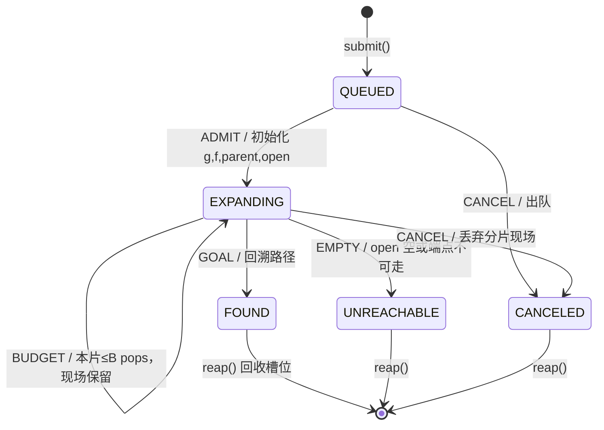
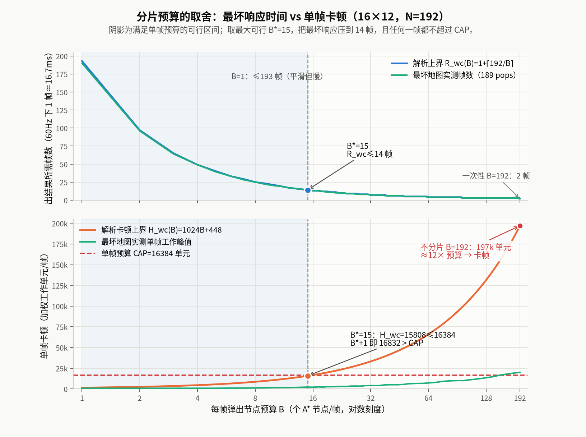

# request

寻路请求状态机：五种状态、显式转移约束、完备性证明、最坏响应时间上界，以及
“响应平滑 vs 单帧卡顿”的分片预算决策。纯 C11 自检，风格与 `grid/`、`region/`
一致。

```sh
make test     # 构建并跑全部 40 项检查（含 20 万事件序列 fuzz、4000 张随机图）
make csv      # 生成 docs/curves.csv（曲线的原始数据）
make chart    # 由 CSV 生成 docs/slice-curves.png（需 matplotlib）
```

实现：`src/request.c`；曲线：`docs/slice-curves.png` / `docs/curves.csv`；
完整自检输出：`docs/test-output.txt`。

---

## 1. 状态转移图

五个状态（`src/request.c` 中的 `enum`，`S_N=5` 只是越界哨兵，不是第六态）：

| 状态 | 含义 | 是否终态 |
|---|---|---|
| `QUEUED` | 排队，已受理未分到帧 | 否 |
| `EXPANDING` | 展开中，A* 分片执行 | 否（有自环） |
| `FOUND` | 找到路径 | 是 |
| `UNREACHABLE` | 确认不可达（open 耗尽 / 起终点不可走） | 是 |
| `CANCELED` | 被取消 | 是 |

触发器（输入字母表 Σ，共 5 个）：`ADMIT`（调度器给首帧）、`BUDGET`（本片弹满
且 open 非空，内部触发）、`GOAL`（弹出终点，内部触发）、`EMPTY`（open 耗尽）、
`CANCEL`（外部取消）。



`reap()` 之后槽位回到分配器（等价于图外的 `[*]`），**不是第六个运行状态**；
新请求 `submit()` 重新从 `QUEUED` 进入。

### 边表：每条边的触发条件与帧预算

| 边 | 转移 | 触发条件 / 动作 | 最坏几帧 | 该帧工作上界 |
|---|---|---|---:|---:|
| e1 `ED_ADMIT` | Q→E | 调度器在下一帧边界准入；初始化 N 个 g/f/parent/closed 数组，压入起点 | **1** | 4N+32 = 800 单元 |
| e2 `ED_BUDGET` | E→E | 本片已弹满 B 个节点且 open 仍非空；g/f/open 跨帧保留 | **1 / 次** | 1024B 单元 |
| e3 `ED_GOAL` | E→F | 弹出的节点就是 goal；父链回溯生成路径 | **1** | 1024B+448 单元 |
| e4 `ED_EMPTY` | E→U | open 表为空（或起/终点不可走，首片即空） | **1** | 1024B+448 单元 |
| e5 `ED_CANCEL_Q` | Q→C | 排队期间收到 CANCEL | **1** | O(1) |
| e6 `ED_CANCEL_E` | E→C | 展开期间收到 CANCEL，丢弃分片现场 | **1** | O(1) |

其余 19 个 `(状态, 触发)` 组合在转移表中全部显式标为 **ignore（恒等转移）**：
终态拒绝一切触发；`QUEUED` 时到达的 `GOAL/EMPTY/BUDGET`、`EXPANDING` 时重复的
`ADMIT` 都被忽略并计数（`r->ignored`），状态不变。无法识别的事件 id 同样按
恒等处理。

---

## 2. 完备性证明：任意输入序列都不会停在第六种状态

设状态集 S = {Q, E, F, U, C}，输入字母表 Σ = {ADMIT, BUDGET, GOAL, EMPTY,
CANCEL}（另加“越界事件 id”这一防御性输入）。

**第一步：δ 是 S×Σ→S 上的全函数。**
`DELTA[5][5]` 的 25 个格子全部显式初始化，每格要么是一条目标状态 ∈ S 的真实
边，要么是带 `defined=1` 标记的 `IGNORE()`（目标写成哨兵 `S_N`，由
`fsm_step` 解释为“返回当前状态”）。不存在 C 零初始化造成的暗格——自检
`table_25_cells_defined` 逐格检查 `defined`，`delta_edges_exact` 把 6 条边和
19 个忽略格的位置与一张期望矩阵逐一比对。事件 id 越界时 `fsm_step` 直接返回
原状态。因此全函数

δ̄(s, e) = 表格是真实边 ? 表格目标 : s

对所有 `(s,e) ∈ S×Σ` 都有定义，且 δ̄(s,e) ∈ S。

**第二步：对输入序列长度归纳。**
命题 P(k)：从任意 s₀ ∈ S 出发，对任意长度 k 的事件序列 e₁…e_k，
s_k = δ̄\* 仍属于 S。

- k=0：s₀ ∈ S，成立。`submit()` 还保证真实请求的初态是 Q。
- 归纳：若 s_{k−1} ∈ S，则由第一步 δ̄ 是全函数且像集 ⊆ S，
  s_k = δ̄(s_{k−1}, e_k) ∈ S。

故任意有限输入序列（包括乱序、重复、取消后再发 GOAL、非法事件 id）的终点都在
五个状态之内，不存在第六态。

**第三步：终态吸收。**
F/U/C 三行的 5 格全是 ignore，所以一旦到达结果状态，任何后续输入都不能再移动
它，直到 `reap()` 把槽位还给分配器。

**机械佐证（不是证明本身，但能防止代码/表格漂移）：**

- `exhaustive_sequences_depth6_closed`：对 5 个起点穷举深度 6 的全部 5⁶ 叉
  事件序列（约 9.8 万条路径节点），每一步都断言状态 ∈ [0,5)；
- `fuzz_200k_sequences_no_sixth_state`：20 万条随机序列，事件 id 故意取
  `[-2, E_N+2)` 以覆盖非法 id，每步断言状态落在五态内；
- `fuzz_terminal_states_absorbing`：fuzz 中一旦进入 F/U/C，后续事件不得改变它。

---

## 3. 用图上的最长路径反解最坏响应时间

图里 e2 是自环，朴素“最长简单路径”会忽略它，而响应时间恰好由它的**重复次数**
决定。必须先用搜索算法的结构给自环次数一个上界：

**展开次数上界 P ≤ N = W·H = 192。**
本实现的 A* 与 `grid/src/grid.c` 同构：open 中同一格在插入前做过去重扫描，不会
有重复条目；节点弹出后立即置 `closed`，邻居扩展跳过 closed，且 4 邻域 +
Manhattan 启发满足一致性，closed 节点不会重开。因此每次 pop 消耗一个不同的
格子，全程 pop 数 P ≤ N。

设每帧最多弹 B 个节点（分片预算），则分片数

S(B) = ⌈P/B⌉ ≤ ⌈N/B⌉。

前 S−1 片每片以 e2（BUDGET 自环）结束，最后一片以 e3（GOAL）或 e4（EMPTY）
结束。于是从 QUEUED 到出结果的**最长合法游走**为

e1 + (⌈N/B⌉ − 1)·e2 + e3/e4

边数 = 1 + (⌈N/B⌉ − 1) + 1 = **R_wc(B) = 1 + ⌈192/B⌉ 条边**。

每条边最坏 1 帧（见边表），边数逐帧相加即最坏响应时间上界：

**WCRT(B) ≤ 1 + ⌈192/B⌉ 帧。**

取消路径 Q→C 为 1 边、Q→E→C 为 2 边，被上式支配（B=192 时上界恰为 2）。

这个界是紧的：自检构造了“角落实心口袋图”——只堵 `(14,11)`、`(15,10)` 两格，
把终点 `(15,11)` 孤立，起点连通分量恰好 189 格，A* 会把这 189 格全部 pop 完才
EMPTY（`pocket_pops_match_structural_bound`）。B=15 时实测 14 帧，正好等于
R_wc(15)=14。

> 帧的含义是“调度器回合”：模型约定每帧只跑一个 ≤B pops 的分片。整张 192 格
> 地图的最坏搜索在本机实测墙钟仅约 16 µs（见 `timing case=unreachable` 行），
> 所以 14 帧 ≈ 233 ms（60 Hz）是**协作式分片的调度延迟上界，不是 233 ms 的
> CPU 计算量**；目标机标定工作单元耗时后可直接换算成毫秒。

---

## 4. 两条曲线定分片：最坏响应时间 × 单帧卡顿

单帧卡顿用加权工作单元度量（热循环每次比较计 1，每个 pop 预留 64 覆盖 O(1)
算术，回溯预留固定权重）。一次 pop：选最小扫 open ≤ N 次，至多 4 次成员查找
扫描 ≤ 4N，故 ≤ 5N+64 = **1024 单元/pop**；终点帧的路径回溯至多两条 N 长
游走，加固定权重为 **2N+64 = 448**。因此单帧工作上界：

**H_wc(B) = 1024B + 448（单元/帧）** —— 随 B 线性上升；
**R_wc(B) = 1 + ⌈192/B⌉（帧）** —— 随 B 双曲线下降。

取每帧拨给寻路的工作预算 `FRAME_WORK_CAP = 16384` 单元（调参常量；落地时用
`帧时间预算ns / 每单元实测ns` 替换）。决策规则：在 H_wc(B) ≤ CAP 的前提下取
**最大的 B**，从而把响应时间压到最小：

1024B + 448 ≤ 16384 ⇒ B ≤ 15.56 ⇒ **B\* = 15**（H_wc=15808；B=16 时
16832 > CAP），对应 **R_wc(15) = 14 帧**。



- 左上端 B=1：每帧只 pop 1 个节点，帧帧平滑，但最坏 193 帧才出结果；
- 右下端 B=192（不分片、一次性算完）：只要 2 帧，但该帧工作上界
  H_wc(192)=197056 ≈ **12× CAP**，按模型必然卡帧；口袋图实测单帧峰值
  19887 单元也确实越过了 16384 预算——解析界保守，但实测结论同向；
- 阴影区是 H_wc ≤ CAP 的可行区间，边界即 B\*=15。

实测曲线（绿）全程低于解析曲线（橙/蓝），192 个 B 档位逐档验证
`frames ≤ R_wc(B)` 且 `hitch ≤ H_wc(B)`
（`slice_sweep_192_budgets_within_bounds`）。

### 关于“分片后状态更多”

本实现用 **E 状态上的 BUDGET 自环 + 记录里的 `slice/pops` 计数器**表达分片，
顶层状态始终是 5 个。另一种建模范式是把“第 k 片”物化成显式子状态 E_k，那时
状态数会变成 4 + ⌈N/B⌉：B=15 时 17 态，B=1 时 196 态——这就是“可分片则状态
更多”的来源。自环 + 扩展状态（计数器）拿到了同样平滑的调度，却不让枚举膨胀，
而第 3 节的游走长度推导对两种建模完全一致。

---

## 5. 五种状态：各一次进入与离开的用例

每个状态都有具名的进入/离开断言；终态的“离开”分两层验证：一切触发器拒绝
移动（吸收性），以及 `reap()` 触发一次 exit 动作回收。

| 状态 | 进入用例 | 离开用例 |
|---|---|---|
| `QUEUED` | `enter_queued`：submit 后状态=Q 且 enter 计数=1 | `leave_queued`：首帧 ADMIT → E，exit(Q)=1、enter(E)=1；附带 `queued_stray_goal_ignored` |
| `EXPANDING` | `enter_expanding`：ADMIT 后 enter(E)=1 | `leave_expanding`：口袋图 EMPTY → U，exit(E)=1；另有 `expanding_budget_self_loop`（见过 e2 自环）、FOUND 用例的 GOAL 离开、`cancel_from_expanding_edge` 的 CANCEL 离开 |
| `FOUND` | `enter_found`：开放图 (0,0)→(3,0) GOAL，路径长度 4 且逐格合法 | `found_refuses_all_triggers`（5 个触发全打一遍仍 F）→ `leave_found`：reap 时 exit(F)=1；`reap_fires_once` 验证不重复 |
| `UNREACHABLE` | `enter_unreachable`：口袋图 189 pops 后 EMPTY | `unreachable_refuses_all_triggers` → `leave_unreachable`：reap exit(U)=1 |
| `CANCELED` | `enter_canceled`：排队中 CANCEL，走 e5 | `canceled_refuses_all_triggers` → `leave_canceled`：reap exit(C)=1；另有 `cancel_from_expanding_edge` 覆盖 e6 |

六条边由 `all_six_edges_exercised` 逐一构造经过。每个生命周期用例随后都调用
WCRT 校验：`wcrt_queued_lifecycle`、`wcrt_expanding_pocket`、`wcrt_found`、
`wcrt_unreachable`、`wcrt_cancel_queued`、`wcrt_cancel_expanding`，在 B\*=15
契约下全部满足实际帧数 ≤ 14。另有 `random_corpus_4000_within_wcrt_and_cap`：
4000 张随机阻挡密度（0/8/16/24%）、随机起终点的地图，断言终态合法、
pops ≤ 192、frames ≤ 14、hitch ≤ CAP、FOUND 路径逐格相邻且可行，以及 WCRT
报告无违规。

---

## 6. 超时怎么办：实际上报与“卡住的那条边”

`req_wcrt_check(r, contract_B)` 给每类边分配聚合帧配额：

- ED_ADMIT = 1，ED_BUDGET = ⌈N/B⌉−1，ED_GOAL/EMPTY/CANCEL_Q/CANCEL_E 各 1；

这些配额沿一条最长路径求和正好等于 R_wc(B)。当 `r->frames > bound_frames`
时，报告器比较每种边的 `edge_frames[e] − allowance[e]`，取超额最大的边作为
**卡住的边**，按如下格式打印实际时间与边：

```
WCRT_VIOLATION case=<用例> actual_frames=<实际帧> bound_frames=<上界> \
  actual_wall_us=<墙钟µs> stuck_edge=<from->to/TRIGGER> \
  edge_actual_frames=<该边实际> edge_allowance_frames=<配额>
```

负向自检注入了两种典型超时，仓库实跑输出（这两行是**预期的违规报告**，对应
检查项 `overrun_*_reported=1`，套件仍 `all_ok=1`）：

```
WCRT_VIOLATION case=injected_goal_stall actual_frames=46 bound_frames=14 actual_wall_us=4.4 stuck_edge=EXPANDING->FOUND/GOAL edge_actual_frames=41 edge_allowance_frames=1
WCRT_VIOLATION case=b1_against_b15_contract actual_frames=190 bound_frames=14 actual_wall_us=15.9 stuck_edge=EXPANDING->EXPANDING/BUDGET edge_actual_frames=188 edge_allowance_frames=12
```

1. `overrun_stall_reports_stuck_goal_edge`：给 GOAL 边注入 40 帧调度停顿，
   总实际 46 > 14，定位到 `EXPANDING->FOUND/GOAL`（该边 41 帧 vs 配额 1）；
2. `overrun_tiny_b_reports_stuck_budget_loop`：把 B=1 的请求按 B\*=15 的部署
   契约验收，实际 190 > 14，定位到 BUDGET 自环（经过 188 次、占 188 帧 vs
   配额 12）。同一条请求按它自己的 B=1 上界 R_wc(1)=193 验收则通过
   （`tiny_b_passes_its_own_bound`）——说明“违规”是相对于所声明契约的。

---

## 7. 复现

```sh
make -C request test
make -C request csv chart
```

环境：gcc 13 / `-std=c11 -Wall -Wextra`，无第三方 C 依赖；曲线脚本仅用
matplotlib。已额外通过 ASan+UBSan（`-fsanitize=address,undefined`）干净运行。
