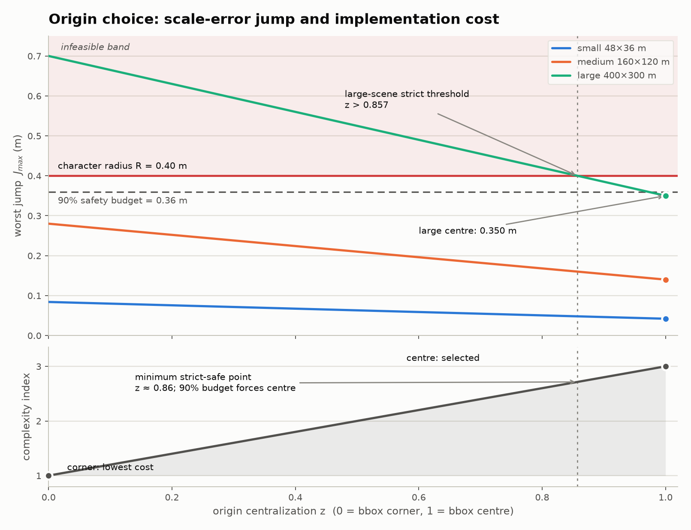

# switch

Fine-grid / coarse-grid origin alignment and switch-position jump check.

```sh
make test   # fit bbox transform and run three scene sizes
make plot   # emit origin_curve.csv and origin_tradeoff.png
```

## Transform

For matching fine and coarse bounding boxes \(B_f,B_c\),

\[
p_c=s p_f+t,
\qquad
s=\frac{x_c^{\max}-x_c^{\min}}{x_f^{\max}-x_f^{\min}},
\qquad
t=x_c^{\min}-s x_f^{\min}.
\]

The y translation is solved in the same way. If x/y scales differ, use
\((s_x,s_y)\) instead of one uniform `s`.

After choosing an origin/pivot \(o_f\), re-anchor translation there:

\[
\hat p_c=o_c+\hat s(p_f-o_f),\qquad o_c=s o_f+t.
\]

With scale error \(\Delta s=\hat s-s\) and zero translation error at the
pivot, the switch jump is

\[
J(p)=|\Delta s|\,\|p_f-o_f\|.
\]

Thus the maximum allowed absolute scale error over switch points at maximum
distance \(D_f\) is

\[
|\Delta s|_{\max}<\frac{R}{D_f}.
\]

Equivalently, with relative scale error \(\eta=\Delta s/s\) and physical
distance \(r_m\) from the pivot, \(J_m=|\eta|r_m\), so
\(|\eta|_{\max}<R/r_{\max}\).

Use the maximum distance to all portal/switch points; using the bbox corner
radius gives a conservative whole-scene bound.

## Demo assumptions

The prompt does not supply concrete dimensions, so the self-test uses these
representative values:

| Tier | Scene size | Fine grid | Coarse grid |
|---|---:|---:|---:|
| small | \(48\times36\) m | \(192\times144\) cells, 0.25 m | \(48\times36\) cells, 1 m |
| medium | \(160\times120\) m | \(640\times480\) cells | \(160\times120\) cells |
| large | \(400\times300\) m | \(1600\times1200\) cells | \(400\times300\) cells |

Character radius \(R=0.40\) m; injected scale error
\(\Delta s=0.00035\) coarse cells/fine cell, equivalent to 0.14% relative
scale error.

## Result

A bbox-min corner origin fails only on the large scene:

```text
VIOLATION tier=large_400x300m origin=corner jump=0.696500m >= radius=0.400m
fine_xy=(1712.000, 1114.000)
coarse_true=(368.000, 348.500)
coarse_estimated=(368.557, 348.918)
```

A bbox-centre origin halves the worst distance and passes all tiers:

| Tier | Portal jump | Worst bbox jump | `< 0.40 m` |
|---|---:|---:|:---:|
| small | 0.0385 m | 0.0420 m | yes |
| medium | 0.1365 m | 0.1400 m | yes |
| large | 0.3465 m | 0.3500 m | yes |

For the large scene, \(J_{\max}(z)=0.70(1-z/2)\) m where \(z=0\) is corner
and \(z=1\) is centre. The strict radius condition needs \(z>0.857\); a 90%
radius safety budget needs \(z\ge0.971\), so the standard centre pivot is
selected.

The complexity curve is an explicit planning proxy,
\(C(z)=1+2z\): the bbox corner needs no pivot/sign conversion, while the
centre needs signed offsets and parity/pivot handling. Replace this proxy
with team-specific implementation estimates if necessary. The safety
constraint remains a hard constraint; complexity is minimized only among
origins that satisfy it.


